  
  
  
  
  
  

## Hi, I'm Kirill (weirdboot)
Backend and systems programming enthusiast. I write Go for practical tools and APIs, and I'm currently going deeper into Rust for performance-critical work.

I aim to optimize everything that can be optimized. I love free and lightweight software.

## About me
I'm into physics, math, and algorithms — the kind of problems that make you think. I spend most of my time in Linux, building small things that make my workflow faster.

## Featured Project
**[fm_tools](https://github.com/weirdboot/fm_tools)** — a command-line file manager written in Go. Supports `cp`, `cd`, `rm`, `ls`, `grep`, `mv`, and more. Built with an eye for clean CLI UX and cross-platform releases.

## What I'm working on
- Building CLI tools (like `fm_tools`)
- Learning Rust through small systems projects

## Tech I use
- **Go** — CRUD APIs, CLI tools
- **Rust** — currently learning, small exercises
- **C** — computer understanding
- **Linux** — daily environment

## GitHub Stats

  
  

## Get in touch
- [Telegram](https://t.me/weirdboot)
- [LeetCode](https://leetcode.com/u/weirdboot/)
- [YouTube](https://www.youtube.com/@weirdboot)
- Discord `@weirdboot`
